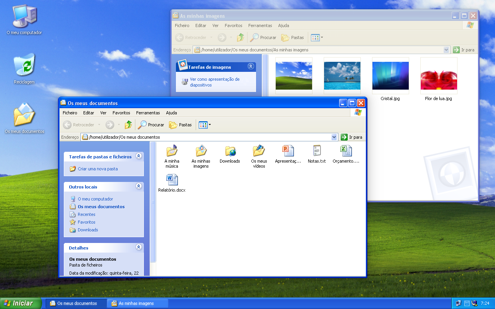
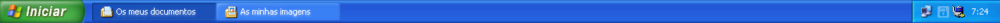
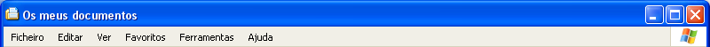
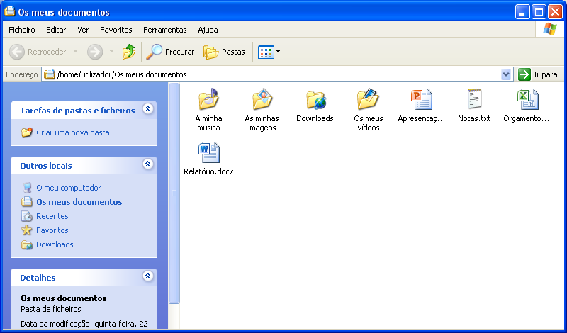
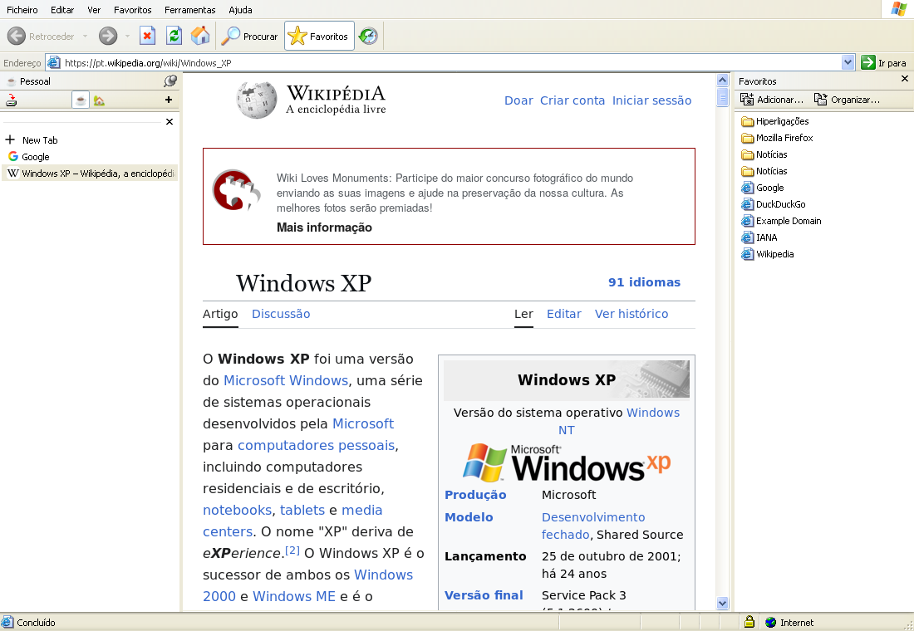
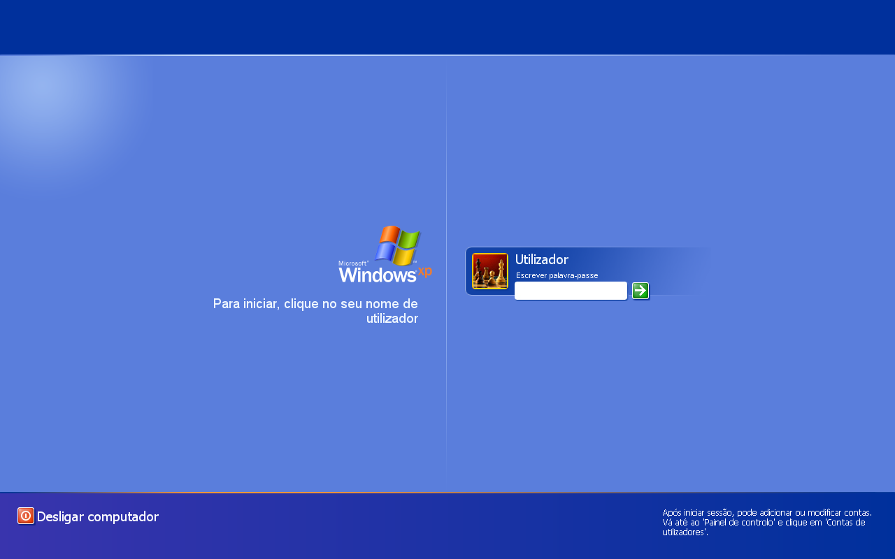
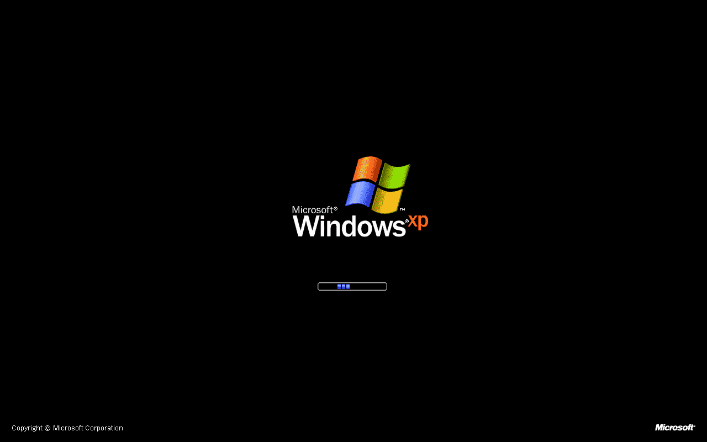

# Zorin XP

Windows XP (Luna theme, blue) on Zorin OS 18.1: taskbar, Start menu,
windows, menus, Explorer, Open/Save dialogs, sounds, cursors, welcome screen,
boot screen and Internet Explorer 6 (on Zen Browser).

It is not a hand-drawn imitation. The images, texts, sounds, fonts and
cursors come from Windows XP's own files (luna.msstyles, shell32.dll,
explorer.exe, msgina.dll, logonui.exe, …), and every piece was measured
pixel by pixel against screenshots of a real Windows XP. Zorin's menu layout
stays; only the look changes.

The interface texts are in European Portuguese, taken from the Portuguese
Windows XP (English UI names are given in parentheses below). An English
version is planned.

---

## Screenshots



**Taskbar** — the Start button, window buttons and the notification area:



**Title bar** — XP caption, buttons and menu bar:



**Files as the XP Explorer** — task pane, toolbar, address bar and XP icons:



**Zen Browser as Internet Explorer 6** — with the Favorites bar:



| Welcome screen | Boot screen |
|---|---|
|  |  |

---

## Requirements

- **Zorin OS 18.1** (GNOME 46) in an **X11 session** (the window frames rely
  on X11's `mutter-x11-frames`).
- The Zorin extensions that ship with it: Zorin Menu, Zorin Taskbar, Zorin
  Desktop Icons and User Themes.
- Packages (most already come with Zorin):

  ```bash
  sudo apt install git python3-pil python3-gi python3-nautilus gcc ffmpeg gnome-session-canberra plymouth
  ```

  - `git`: to clone the project (a fresh Zorin does not have it);
  - `python3-nautilus`: Files as the XP Explorer (`explorer` component);
  - `gcc`: "O meu computador" (My Computer) and "Reciclagem" (Recycle Bin)
    in Files (`folders` component);
  - `ffmpeg`: the Internet Explorer click sound in Zen (`zen` component).
- Optional: **Zen Browser** as a Flatpak (`app.zen_browser.zen`), for the
  Internet Explorer 6 look.

## Install

```bash
git clone https://github.com/nuno2msilva/zorin-xp-theme.git
cd zorin-xp-theme
./install.sh
```

Without arguments it installs everything. The welcome screen
and the boot screen ask for the administrator password. When it finishes,
**log out and back in**: some settings (fonts, cursors, file dialogs) only
apply to a new session.

You can also install just some parts:

```bash
./install.sh shell extension
```

| Component | What it installs |
|---|---|
| `sounds` | the XP sound scheme |
| `cursors` | the XP cursors (also in X11 and Flatpak apps) |
| `fonts` | the XP fonts (Tahoma, Trebuchet MS, Franklin Gothic, …) and XP-style hinting |
| `gtk` | the GTK 3 and GTK 4/libadwaita window theme |
| `shell` | the taskbar, the Start button and menu, and the Zorin layout |
| `extension` | the GNOME Shell extension (what CSS alone cannot do) |
| `icons` | the XP icons |
| `folders` | home folders with the XP names and the XP desktop |
| `explorer` | Files as the XP Explorer |
| `filechooser` | the XP Open and Save As dialogs in every app |
| `zen` | Zen Browser as Internet Explorer 6 (with Zen **closed**) |
| `logon` | the welcome screen and lock screen (sudo) |
| `boot` | the XP boot screen (sudo) |

Everything is **copied**: after installing, the project folder can be
deleted. Almost everything goes into your home folder; system files are not
modified. Only two components write outside it, with sudo, into folders of
their own: `logon` (the `gdm` user's folder, `/var/lib/gdm3`) and `boot`
(`/usr/share/plymouth/themes/windows-xp`).

The Zen extension only starts from the **second** time Zen opens after it is
installed.

## Uninstall

```bash
~/.local/share/zorin-xp/uninstall/rescue/restore.sh
```

Before the first install, a copy of your settings (GTK, dconf, config files)
is saved to `~/.local/share/zorin-xp/backup/original`. `restore.sh` deletes
everything the installer recorded (`~/.local/share/zorin-xp/installed-files.txt`),
undoes the sudo changes (welcome screen, boot screen), gives the home
folders their previous names back and restores that copy. It works without
the project folder, and also from a text console (Ctrl+Alt+F3) if the
graphical session does not start. Afterwards: Alt+F2, `r`, Enter (or log
out).

---

## What changes

### Taskbar

- 30 px bar with the Luna background; window buttons with a 16 px icon and
  text, without GNOME's indicators, at XP's measurements; the show-desktop
  button to the right of the clock.
- **Start button** drawn the way XP draws it: the label ("Iniciar", Start)
  comes from `explorer.exe` and is drawn at build time with the theme's font,
  colour and shadow (the "continuous" shadow follows `comctl32.dll`'s
  algorithm); the width follows the text. It matches XP screenshots pixel for
  pixel (except 2 pixels).
- XP notification area, with the "show hidden icons" arrow.
- App context menus on the taskbar look like XP menus.
- Explorer windows show the icon of the open folder, and Zen shows the open
  page's icon (also in the window caption).
- The taskbar settings open as an XP property sheet, as does Zorin
  Appearance.

### Start menu

- Zorin's menu with the bands, colours and measurements of the XP Start menu
  (380 px): user picture and name at the top, Zorin's categories on the left
  with "Todos os programas" (All Programs), places on the right (Os meus
  documentos, Ambiente de trabalho, As minhas imagens, A minha música, O meu
  computador — My Documents, Desktop, My Pictures, My Music, My Computer —
  then Programs, Settings, Zorin Appearance, Internet, Downloads, Terminal),
  "Terminar sessão" (Log Off) and "Encerrar" (Turn Off) at the bottom.
- The XP shadow around the menu, the XP scrollbar in the lists, invisible
  search (just type).

### Windows

- GTK 3 and GTK 4/libadwaita theme generated from `luna.msstyles`: buttons,
  boxes, tabs, scrollbars, lists, menus, toolbars.
- 30 px title bars with the XP buttons (minimise, maximise, close), also on
  server-side framed windows (xterm, VirtualBox, …), with 4 px borders and
  the icon and title at XP's positions.
- Dialogs can be dragged (as in XP); scrollbars always visible.
- Fonts with XP-style hinting (TrueType interpreter v35) and whole-pixel
  sizes as in XP; browsers and Electron apps keep the normal hinting so
  their letter spacing is not broken (`zorin-xp-browser-fonts`).

### Files = XP Explorer

- The Explorer's title bar, menus, toolbar and address bar, and the blue
  task pane on the left (with "Atalhos", shortcuts to saved folders).
- The XP views — Thumbnails, Tiles, Icons, List, Details — with XP's
  measurements and selection, names cut the way XP cuts them, and the shaded
  sorted column.
- Create, rename and delete as in XP (edit box, confirmations with the texts
  from `shell32.dll` and the Recycle Bin sound); the XP click when changing
  folders; no zoom.

### Open and Save As dialogs

- They replace GNOME's in every app (file chooser portal): the `comdlg32.dll`
  dialog with the places bar (Desktop, My Documents, My Computer, My
  Pictures, Downloads), the five views, menus, rename, delete and the resize
  grip.
- The five views are the Explorer's: the same rules (measurements, how names
  are cut, selection, the rename box) live in one place,
  `src/common/xpviews.py`, used by both and by the theme's Explorer CSS.
- "Procurar em" / "Guardar em" (Look in / Save in) shows the folder's whole
  path after its icon and takes a path written by hand (Enter opens that
  folder) — instead of XP's drop-down list.
- XP's "Procurar pasta" (Browse for Folder) for picking folders, with the
  tree's [+]/[-] and its keys (→ opens a folder, ← closes it); "Pasta:" shows
  the whole path (Enter on another path opens it in the tree).
- If anything fails, GNOME's dialog opens instead.

### Folders and desktop

- Home folders with the XP names: Os meus documentos (My Documents, with As
  minhas imagens, A minha música, Os meus vídeos and Downloads inside it),
  Ambiente de trabalho (Desktop), Documentos partilhados (Shared Documents),
  Modelos (Templates); the old names keep working (hidden links).
- "O meu computador" (My Computer) and "Reciclagem" (Recycle Bin) in Files
  and on the desktop.
- Desktop with XP's grid and labels, rename on the icon itself, XP delete
  confirmations and the XP right-click menu (Arrange Icons By, Refresh,
  Paste, Paste Shortcut, New, Properties).

### Sounds, cursors, fonts and icons

- The XP sound scheme (logon and logoff, alerts, Recycle Bin, …).
- The XP cursors, also in X11 and Flatpak apps.
- All the XP fonts, taking priority over the system's copies.
- About 200 XP icons for folders, drives, file types (including Office's)
  and apps; the menu categories keep Zorin's icons.

### Logon and logoff

- XP **welcome screen** instead of GNOME's login screen (account list,
  password, "Desligar computador" / Turn Off Computer), also used as the lock
  screen; if anything fails, GNOME's appears.
- "bem-vindo" (welcome) and "A carregar as suas definições pessoais..."
  (Loading your personal settings...) while the session starts, with the XP
  startup music.
- XP "Turn Off Computer" and "Log Off" dialogs, the desktop fading to grey,
  and the "Logging off..." / "Windows is shutting down..." screens with the
  XP sounds.
- XP **boot screen** (Plymouth) with the running bar.

### Zen Browser as Internet Explorer 6

- IE6 toolbars, address bar and status bar, with XP's buttons and the logo
  animation; title "… - Microsoft Internet Explorer".
- IE6 Favorites and History bars and the Find window (Ctrl+F); the tab bar
  with the same look, a pin to keep it shown or auto-hide it, and new tabs
  flashing like taskbar buttons.
- IE6 error page, XP scrollbars in web pages, page dialogs, information bar,
  tooltips, the IE click when a page opens, and media controls styled like
  Windows Media Player.
- Opens the last visited page; Save As remembers the folder per site.
- All of it comes in one extension, *Zorin XP: Internet Explorer*: its
  **Preferences** (`about:addons`, ⋯ > Preferências) turn each feature on and
  off at once.

---

## Project layout

```
assets/      the XP resources, already extracted, with readable names
             (each folder has an ORIGEM.md saying which Windows file each
             one comes from)
  themes/luna/    images and definitions of the Luna theme (luna.msstyles)
  icons/ cursors/ sounds/ fonts/ images/
  locales/pt-PT/  texts, dialogs and menus of the XP programs, by id
src/         the theme's code and stylesheets (Shell extensions, GTK CSS,
             Explorer, file dialogs, Zen, ...); common/ has the views' rules
             the Explorer and the file dialogs share
tools/
  extract.py     extracts from a copy of Windows into assets/ (catalog.py
                 says what and from where)
  build.py       builds the theme from assets/ and src/ into build/
  lib/ builders/ setup/ test/
system/      what runs with sudo (welcome screen, boot screen)
rescue/      backup and restore
docs/        the README screenshots (tools/test/shelltest/session.sh makes them)
```

The build only reads `assets/`. To extract the resources again (for example
from another language), copy the `Windows` folder of an XP install to
`windows/<name>` and run:

```bash
python3 tools/extract.py --windows windows/xp-pro-pt --locale pt-PT
python3 tools/build.py --out build
```

## Known limitations

- Made and tested only on Zorin OS 18.1 with X11.
- A Zorin update that changes the desktop icons brings back Zorin's grid
  until `./install.sh folders` is run again.
- PDF files still have the generic document icon.
- Text in the Start menu and the taskbar uses GNOME's letter spacing (letters
  can be 1 px off compared with XP).
- Portuguese only for now; an English version is planned.

## License

The code in this repository (everything outside `assets/`) is licensed under
the GNU General Public License v3.0 or later — see [LICENSE](LICENSE). You
are free to fork, modify and redistribute it under the same license.

The files in `assets/` are **not** covered by this license; see the legal
notice below and [assets/NOTICE.md](assets/NOTICE.md).

## Legal notice

This is an unofficial, non-commercial fan project. It is not affiliated
with, endorsed by or sponsored by Microsoft Corporation or Zorin Group.

Microsoft, Windows, Windows XP, Internet Explorer and Windows Media Player
are trademarks of Microsoft Corporation. The files in `assets/` (images,
icons, cursors, sounds, fonts and texts) were extracted from Windows XP and
remain the property of Microsoft and of the respective font foundries. They
are included only so the theme can be built; no rights over them are
granted by this project.

If you hold rights to any of these files and want them removed, please open
an issue and they will be taken down.
